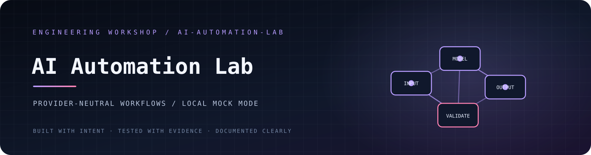
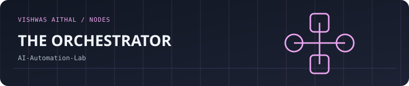
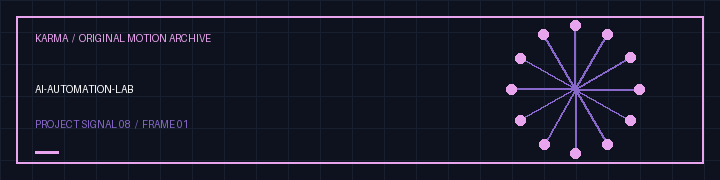

<!-- VISHWAS.EXE UNIFIED THEME START -->
<p align="center"><a href="https://github.com/vishwasaithalz/AI-Automation-Lab"></a></p>

<p align="center"><a href="https://vishwasaithalz.github.io/vishwasaithalz/">Personal index</a> &nbsp;·&nbsp; <a href="https://github.com/vishwasaithalz?tab=repositories">All projects</a> &nbsp;·&nbsp; <a href="https://vishwasaithal.ai.studio/">Portfolio</a></p>
<!-- VISHWAS.EXE UNIFIED THEME END -->

<details>
<summary>Earlier artwork and navigation</summary>

<p align="center"><a href="https://github.com/vishwasaithalz/AI-Automation-Lab"></a></p>
<p align="center"><strong>🤖 AI Automation Lab</strong> · Provider-neutral workflow experiments</p>
<details>
<summary>Build and technology badges</summary>

<p align="center">
<a href="https://github.com/vishwasaithalz/AI-Automation-Lab"></a>
<a href="https://vishwasaithalz.github.io/vishwasaithalz/arcade/#terminal"></a>
</p>

<details><summary>🎨 Open original full-size project artwork</summary>
<p align="center"></p>
</details>

</details>

<p align="center">
  <a href="https://github.com/vishwasaithalz/AI-Automation-Lab/actions/workflows/tests.yml"></a>
  
  
  
</p>
</details>

<p align="center"><strong>Small, testable automation workflows with explicit data and provider boundaries.</strong></p>

<p align="center"><a href="#-architecture">Architecture</a> · <a href="#-quick-start">Quick start</a> · <a href="#-privacy--secrets">Privacy</a> · <a href="#-roadmap">Roadmap</a></p>

## 🚀 Vishwas Aithal engineering workbenches

**Six live interactive prototypes** with independent Vercel projects, GitHub source and automated checks. Each app is a small, measurable demonstration and **does not claim production security certification or enterprise-scale performance**.

| Lab | Try the live app | Review the implementation |
|:--|:--|:--|
| **SentinelPulse** | [Inspect an L7 request](https://karma-sentinelpulse.vercel.app/) | [Python checks, browser workbench, tests](projects/SentinelPulse/) |
| **SERPMatrix** | [Audit SEO metadata](https://karma-serpmatrix.vercel.app/) | [HTML analyzer, sitemap tool, tests](projects/SERPMatrix/) |
| **CloudHardener** | [Analyze Kubernetes JSON](https://karma-cloudhardener.vercel.app/) | [Read-only policy checker and tests](projects/CloudHardener/) |
| **ApexVitals** | [Inspect asset performance](https://karma-apexvitals.vercel.app/) | [Glyph and compression tools](projects/ApexVitals/) |
| **ZeroAuth** | [Try real browser WebAuthn](https://karma-zeroauth.vercel.app/) | [Authenticator code, cryptographic tests](projects/ZeroAuth/) |
| **Spectra UI** | [Explore accessible components](https://karma-spectra-ui.vercel.app/) | [Contrast algorithm, UI and tests](projects/SpectraUI/) |

[All six labs](projects/) · [Chromium desktop/mobile and WebAuthn tests](https://github.com/vishwasaithalz/AI-Automation-Lab/actions/workflows/karma-browser-e2e.yml) · [Daily live checks](https://github.com/vishwasaithalz/AI-Automation-Lab/actions/workflows/karma-live-endpoints.yml) · [Repository test suite](https://github.com/vishwasaithalz/AI-Automation-Lab/actions/workflows/tests.yml)

These are distinct applications inside one GitHub repository, **not** six separate repositories. Secure auth, high-throughput filtering, real cluster auditing and unverified numeric benchmarks remain future work.
**Portfolio reference:** [vishwasaithal.ai.studio](https://vishwasaithal.ai.studio/) is the intended visual/product reference. Its live design must be inspected before claiming a pixel-accurate match. Real Chromium screenshots of the six apps are available in [E2E workflow artifacts](https://github.com/vishwasaithalz/AI-Automation-Lab/actions/workflows/karma-browser-e2e.yml).

**Standalone repository route without TinyFish:** [Reviewed, dry-run-first GitHub CLI publisher](scripts/publish-standalone-repos.ps1). It requires the owner to authenticate with GitHub CLI on their own computer. Nothing automatically creates new repos or changes production Vercel Git connections.


## 🧠 What this is

AI-Automation-Lab is a provider-neutral Node.js workspace for experimenting with workflow design before connecting an external AI service. The initial implementation uses a deterministic mock provider, so the demo runs without API keys or network calls.

### Current capabilities

- Provider adapter interface that separates workflow logic from vendor-specific code.
- Deterministic local mock mode.
- Input validation and predictable error handling.
- Local JSON input and structured output.
- Automated tests using Node.js built-ins.

## ⚡ Quick start

**Requirements:** Node.js 20 or newer and npm.

```powershell
git clone https://github.com/vishwasaithalz/AI-Automation-Lab.git
cd AI-Automation-Lab
npm test
npm run demo
```

Run the example workflow:

```powershell
npm run run -- examples/input.json
```

Export a workflow result to a new JSON file:

```powershell
npm run run -- examples/input.json --output reports\workflow.json
```

The export uses exclusive file creation and will not overwrite an existing report.

## 🧩 Architecture

```text
JSON input
   |
   v
Validation
   |
   v
Workflow runner
   |
   +---- Provider adapter
   |        |
   |        +---- Mock provider (current default)
   |
   v
Structured result
```

The adapter boundary is intentional: workflow code should not need to know which model vendor is used.

## 🔐 Privacy & secrets

- Mock mode is the default and makes no external network calls.
- Never commit API keys, tokens, private prompts, or personal data.
- Store credentials in local environment variables or a secrets manager.
- Review a provider's retention, training, and data-processing terms before sending it information.
- Use synthetic inputs for public examples and tests.

External provider connectivity is not implemented in this initial version. No live AI inference is claimed.

## 🧪 Development

```powershell
npm test
npm run demo
```

## 🗺️ Roadmap

- [ ] Add schema-based input and output contracts.
- [ ] Add bounded retries, timeouts, and cancellation.
- [ ] Add structured logs with secret redaction.
- [ ] Add one optional provider adapter behind explicit configuration.
- [ ] Add cost and token accounting before enabling live model calls.

## 🤝 Contributing

Keep provider-specific code isolated and include tests for success, failure, timeout, and invalid input paths. See [CONTRIBUTING.md](CONTRIBUTING.md) and [SECURITY.md](SECURITY.md).

<p align="center"><sub>Make the workflow reliable before making it clever.</sub></p>


<!-- KARMA VISUAL IDENTITY: START -->
<div align="center">

**WORKFLOWS / SAFETY / AUTOMATION**

 

<sub>Designed for clarity. Built for evidence. No invented status metrics.</sub>

</div>
<!-- KARMA VISUAL IDENTITY: END -->


<p align="center"></p>
<details><summary><strong>Animated project gallery</strong></summary><p><a href="https://karma-ops-monitor.vercel.app">Open the Vishwas Aithal interactive gallery and original audio controls</a>.</p></details>


<!-- KARMA AVATAR GALLERY -->
<p align="center"></p>
<p align="center"><a href="https://karma-ops-monitor.vercel.app/#gallery">Explore the animated project gallery</a></p>


### Original motion gallery



[Download this project's GIF](assets/karma-motion.gif) · [View the animated SVG](assets/karma-signal.svg)
